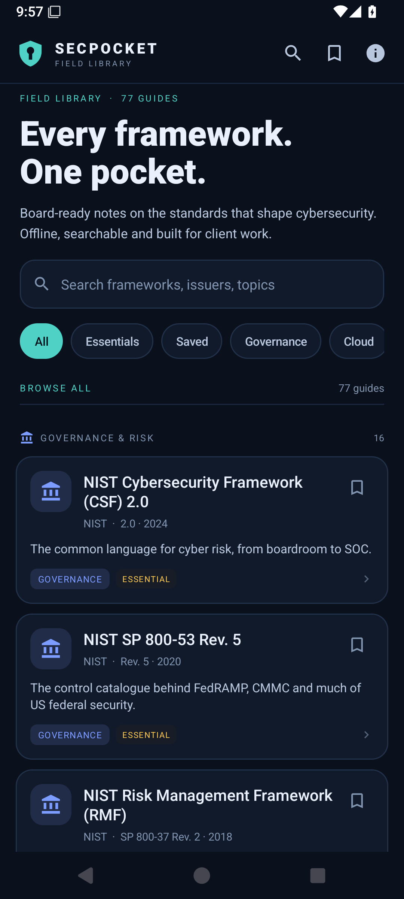
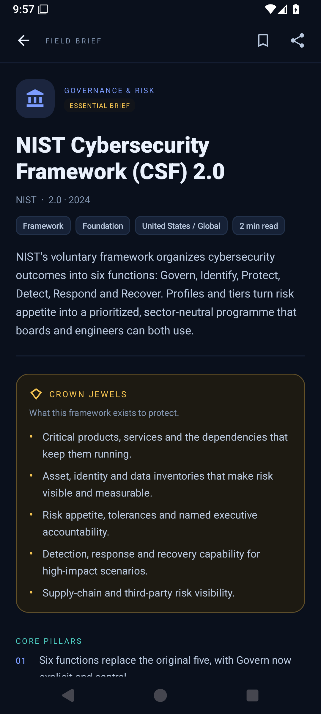
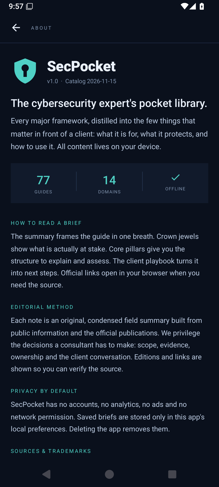

# SecPocket

**Cybersecurity frameworks, in your pocket.**


SecPocket is a fully offline Android field library for cybersecurity consultants. It distills **77 major frameworks, regulations and technical guides** into short, client-ready briefs: what each one is for, what it protects, its core pillars and how to use it in an engagement.

Built for the moments that matter: scoping a new engagement, preparing for a client workshop, or checking a framework's crown jewels before a call.

---

## Download

**[Download the latest APK](../../releases/latest/download/SecPocket-1.0.apk)** · [All releases](../../releases)

- Android 8.0 (API 26) or newer
- ~124 KB, no permissions, fully offline
- Version 1.0 · SHA-256 `983193EA1A415647E1263BF1FBCB2B6AD875EFD0DC85A5EE3A81ED1753761947`

The APK is published as a GitHub release asset, not committed to the repository. To verify it, see [Verify the download](#verify-the-download).

---

## Screens

<p align="center">
  
  
  
</p>

---

## What is inside

- **77 briefs across 14 domains**, including NIST CSF 2.0, NIST SP 800-53, ISO/IEC 27001, ISO/IEC 27701, ANSSI hygiene and SecNumCloud, BSI IT-Grundschutz and C5, NCSC CAF, CIS Controls, PCI DSS, SWIFT CSP, NIS2, DORA, IEC 62443, OWASP Top 10:2025, OWASP ASVS 5.0, MITRE ATT&CK, WPA3, Bluetooth, 5G, NIST PQC and more.
- **26 essential briefs** for the frameworks a consultant reaches for first.
- **Accent-insensitive search** across titles, issuers, editions, summaries, key points, crown jewels, client guidance and tags. Multi-word queries use AND logic. "wifi" finds "Wi-Fi", "hygiene" finds "hygiène", and "ainsi" is accepted as an alias for ANSSI.
- **Domain filters** for Governance & Risk, Cloud, AI & Emerging Tech, Application Security, Identity & Access, Network/Wi-Fi/PAN, Data & Privacy, Payments/PAN, OT/ICS, Incident Response & Threat Intel, Endpoint & Mobility, Supply Chain & Product Security, Resilience & Regulation and Cryptography.
- **Local saved briefs.** Bookmark any guide; saved IDs live only in the app's private preferences.
- **A field brief for every guide:** one-breath summary, crown jewels, numbered core pillars, client playbook, related domains, official source and a share action.

### Catalog at a glance

| Domain | Briefs |
|---|---:|
| Governance & Risk | 16 |
| Cloud | 8 |
| AI & Emerging Tech | 7 |
| Application Security | 8 |
| Identity & Access | 3 |
| Network, Wi-Fi & PAN | 6 |
| Data & Privacy | 5 |
| Payments & PAN | 6 |
| OT / ICS | 3 |
| Incident Response & Threat Intel | 5 |
| Endpoint & Mobility | 3 |
| Supply Chain & Product Security | 3 |
| Resilience & Regulation | 3 |
| Cryptography | 1 |
| **Total** | **77** |

The catalog is curated rather than exhaustive. It covers the standards that most often shape scope, evidence and client conversations. The "Network, Wi-Fi & PAN" domain covers personal-area and wireless networking; "Payments & PAN" covers cardholder data and primary account numbers.

### How to read a brief

| Section | What it answers |
|---|---|
| Summary | What this guide is and why it exists, in a few sentences. |
| Crown jewels | What the framework exists to protect, and what is at stake. |
| Core pillars | The structure you need to explain, scope and assess. |
| Client playbook | Concrete next steps and talking points for an engagement. |
| Also applies to | Adjacent domains where the same guide is relevant. |
| Official source | A link to the issuing body's publication. |

---

## Install

**Requirements:** Android 8.0 (API 26) or newer. No account, no setup, no network.

### On a phone or tablet

1. Download `SecPocket-1.0.apk` from [Releases](../../releases) or copy it to the device.
2. Open the APK from the device's file manager.
3. Allow installation from that source if Android asks.
4. If Play Protect shows a warning, choose **More details → Install anyway**. The APK is self-signed because it is distributed directly, not through Google Play.

### With ADB

```powershell
adb install -r "dist\SecPocket-1.0.apk"
```

The app declares **no permissions**, including no internet access. The only outbound actions are user-initiated: opening an official source in the browser and sharing a brief through the Android share sheet.

---

## Verify the download

Compare the APK hash with the published value:

```powershell
Get-FileHash .\SecPocket-1.0.apk -Algorithm SHA256
```

```
983193EA1A415647E1263BF1FBCB2B6AD875EFD0DC85A5EE3A81ED1753761947
```

On macOS or Linux:

```bash
shasum -a 256 SecPocket-1.0.apk
```

You can also verify the signing certificate:

```powershell
apksigner verify --verbose --print-certs .\SecPocket-1.0.apk
```

The certificate SHA-256 should be `86:35:17:5E:E1:C5:BC:60:D3:B2:7D:DC:F0:DF:D9:41:C9:4F:AB:3B:04:3A:A9:C2:90:EA:2E:1A:1D:85:07:08`.

---

## Build from source

There is no Gradle project. The APK is assembled directly with the Android SDK tools, which keeps the build small and transparent.

### Prerequisites

- Windows PowerShell 5.1 or newer.
- **JDK 21** (the portable build used here is at `%LOCALAPPDATA%\SecPocket\toolchain\jdk-21.0.13+9`).
- **Android SDK platform 35** and **build-tools 35.0.0** (portable SDK at `%LOCALAPPDATA%\SecPocket\sdk`).
- The build script finds the SDK through `ANDROID_SDK_ROOT`/`ANDROID_HOME` or the portable path.

Any recent JDK 21 and Android SDK installation works; set `JAVA_HOME` and `ANDROID_SDK_ROOT` if they are not in the default locations.

### Build

```powershell
powershell -ExecutionPolicy Bypass -File .\build.ps1
```

The script:

1. Compiles resources with `aapt2`.
2. Links the manifest, resources and `assets/frameworks.json` into an unsigned APK.
3. Compiles the Java sources with `javac --release 8`.
4. Converts classes to DEX with `d8`.
5. Adds `classes.dex` to the APK and aligns it with `zipalign`.
6. Signs with `apksigner` using `keystore/release.keystore`. The password is read from `keystore/keystore.properties` or the `SECPOCKET_STOREPASS` environment variable.
7. Verifies the signature and prints the SHA-256 of the APK.

Output: `dist/SecPocket-1.0.apk`.

On a first run with no keystore, the script generates a random password and writes it to the gitignored `keystore/keystore.properties`. Back that file up together with the keystore.

The build directory is disposable. The `dist/` and `keystore/` directories are kept between builds and are excluded from version control.

### Project layout

```
SecPocket/
├─ app/src/main/
│  ├─ AndroidManifest.xml
│  ├─ assets/frameworks.json        # runtime catalog (77 entries)
│  ├─ java/com/secpocket/app/       # Activities, adapter, model, helpers
│  └─ res/                          # layouts, colors, vectors, theme
├─ content/                         # 14 source JSON files, one per domain
├─ docs/
│  ├─ screenshots/                  # README screenshots
│  ├─ release-notes/                # release bodies
│  └─ RELEASING.md                  # publishing checklist
├─ keystore/
│  ├─ release.keystore              # local signing key (not committed)
│  └─ keystore.properties           # local signing password (not committed)
├─ build.ps1
├─ CHANGELOG.md
├─ dist/
│  ├─ SecPocket-1.0.apk             # build output (not committed)
│  └─ SHA256SUMS.txt                # release checksum (not committed)
└─ README.md
```

---

## Content model

`app/src/main/assets/frameworks.json` has this shape:

```json
{
  "version": 1,
  "updated": "2026-11-15",
  "frameworks": [
    {
      "id": "nist-csf-2",
      "title": "NIST Cybersecurity Framework (CSF) 2.0",
      "shortTitle": "NIST CSF 2.0",
      "issuer": "NIST",
      "edition": "2.0 · 2024",
      "region": "United States / Global",
      "primaryTopic": "Governance & Risk",
      "topics": ["Governance & Risk", "Resilience & Regulation"],
      "type": "Framework",
      "level": "Foundation",
      "essential": true,
      "hook": "The common language for cyber risk, from boardroom to SOC.",
      "summary": "…",
      "keyPoints": ["…"],
      "crownJewels": ["…"],
      "clientUse": ["…"],
      "tags": ["…"],
      "link": "https://www.nist.gov/cyberframework"
    }
  ]
}
```

- `primaryTopic` controls the section header on the main list and the icon/color in the UI.
- `topics` powers domain filtering and the "Also applies to" pills.
- `essential` powers the Essentials filter.
- `crownJewels`, `keyPoints` and `clientUse` render as bullet, numbered and check-mark rows.
- `id` is the stable bookmark key. Changing an existing ID silently drops that bookmark, so treat IDs as permanent.
- The 14 topic names must match the controlled vocabulary exactly: `Governance & Risk`, `Cloud`, `AI & Emerging Tech`, `Application Security`, `Identity & Access`, `Network, Wi-Fi & PAN`, `Data & Privacy`, `Payments & PAN`, `OT / ICS`, `Incident Response & Threat Intel`, `Endpoint & Mobility`, `Supply Chain & Product Security`, `Resilience & Regulation`, `Cryptography`.

The files in `content/` are the per-domain editorial sources: each file is a JSON array of framework objects. The merged runtime catalog is `app/src/main/assets/frameworks.json`; update both when changing content, then rebuild. Keep `updated` honest when you revise editions.

### Adding or updating a guide

1. Edit the relevant `content/<domain>.json` and the merged `app/src/main/assets/frameworks.json`.
2. Confirm the JSON parses, IDs are unique and every referenced topic is in the vocabulary.
3. Keep summaries original and concise; link to the official publication rather than reproducing it.
4. Bump `versionCode`/`versionName` in `AndroidManifest.xml` and the output name/version in `build.ps1` for a new release.
5. Run `build.ps1` and reinstall with `adb install -r`.

---

## APK identity and signing

| Property | Value |
|---|---|
| Package | `com.secpocket.app` |
| Version | `1.0` (versionCode 1) |
| Minimum SDK | 26 (Android 8.0) |
| Target SDK | 34 (Android 14) |
| Compiled with | SDK 35 |
| Signature schemes | APK Signature Scheme v2 and v3 |
| Certificate | `CN=SecPocket, OU=Field Library, O=SecPocket, L=Paris, C=FR` |
| Certificate SHA-256 | `86:35:17:5E:E1:C5:BC:60:D3:B2:7D:DC:F0:DF:D9:41:C9:4F:AB:3B:04:3A:A9:C2:90:EA:2E:1A:1D:85:07:08` |
| APK SHA-256 | `983193EA1A415647E1263BF1FBCB2B6AD875EFD0DC85A5EE3A81ED1753761947` |
| Key alias | `secpocket` |
| Keystore | `keystore/release.keystore` (local only, gitignored) |
| Credentials | `keystore/keystore.properties` or `SECPOCKET_STOREPASS` (local only) |

The keystore and its credentials are **not part of this repository**. Keep a secure backup: anyone who has the key can sign updates that Android will accept as the same app. If it is lost, the app must be uninstalled before a differently signed build can be installed, and existing saved briefs will be lost.

A fresh clone without the keystore will generate a new signing key on its first build. That is fine for development, but it cannot upgrade an app signed with the original key. Use the original keystore (and `keystore.properties`) for published releases.

See [docs/RELEASING.md](docs/RELEASING.md) for the full publish and verification checklist.

---

## Privacy and security posture

- **No permissions at all.** In particular, there is no `INTERNET` permission. The app cannot call home.
- **No accounts, analytics, ads, crash reporting or remote configuration.**
- **No cloud backup.** `android:allowBackup="false"` keeps saved briefs off Android backup services.
- **Local saved state only.** Bookmarks are a string set in the app's private `SharedPreferences` (`secpocket_prefs`). Uninstalling the app or clearing its data removes them.
- **No network code.** Opening an official source uses the system browser through an `ACTION_VIEW` intent; sharing uses the system share sheet. Both are explicit user actions.
- **Content is embedded.** `assets/frameworks.json` ships inside the APK and is read at startup. The catalog does not change unless the APK is updated.

---

## Releases

| Tag | APK | Status |
|---|---|---|
| [`v1.0.0`](../../releases/tag/v1.0.0) | `SecPocket-1.0.apk` | First public release |

APKs are attached to releases as binary assets. GitHub also generates **Source code (zip)** and **Source code (tar.gz)** for every tag, so the code and the APK ship together without committing build output.

See [CHANGELOG.md](CHANGELOG.md) for the release history and [docs/RELEASING.md](docs/RELEASING.md) for how to publish the next version.

---

## Accuracy and disclaimer

SecPocket is an independent field aid, not a standards body and not legal advice. The briefs are original, condensed interpretations written for professional orientation and client conversations. They are not the official text, an audit opinion, or a substitute for a framework's requirements.

Editions and links were checked against public sources in November 2026. Standards change; confirm the current edition, scope and applicability before relying on a guide in an engagement. ISO/IEC standards are commercial publications; SecPocket summarizes them at a high level and does not reproduce their text.

NIST, ISO/IEC, ANSSI, BSI, NCSC, CISA, ACSC, OWASP, MITRE, CIS, CSA, PCI SSC, SWIFT, 3GPP, Wi-Fi Alliance, FIDO Alliance and other names are trademarks or registered trademarks of their respective owners. SecPocket is not affiliated with or endorsed by any standards body.

---

## License

Copyright © 2026 the SecPocket author. All rights reserved.

The source code and editorial briefs are published for reference and for use of the SecPocket app. You may download and use the APK for professional work. No permission is granted to redistribute, sublicense or sell the code or content without written permission. If you would like to reuse the project, please open an issue.

Standards, frameworks and trademarks referenced in the app remain the property of their respective owners.

---

**SecPocket 1.0** · Built for the field.
